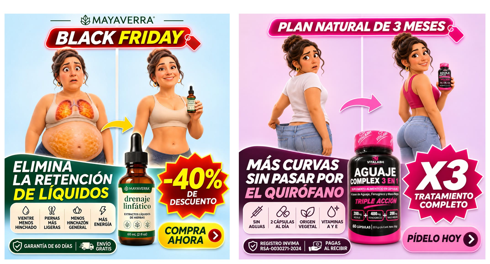
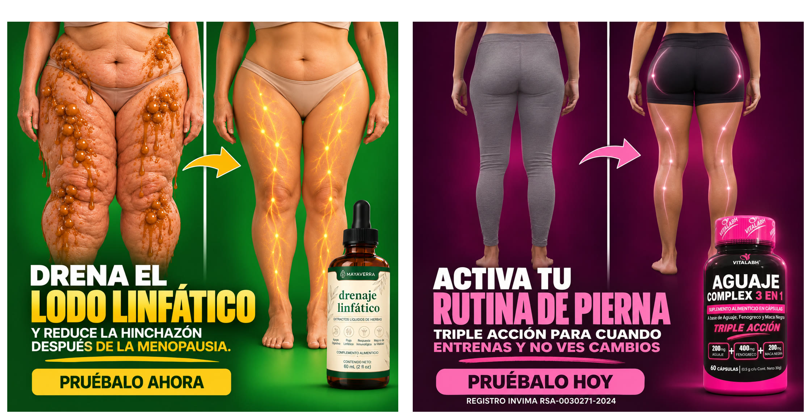
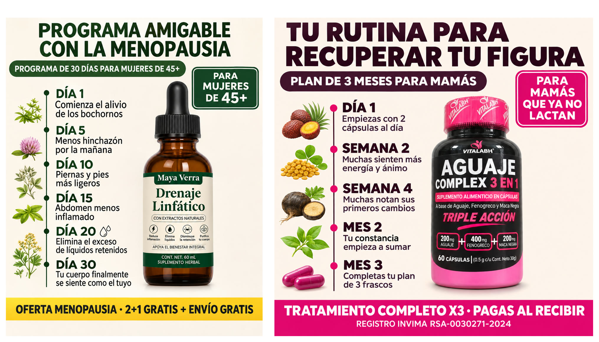
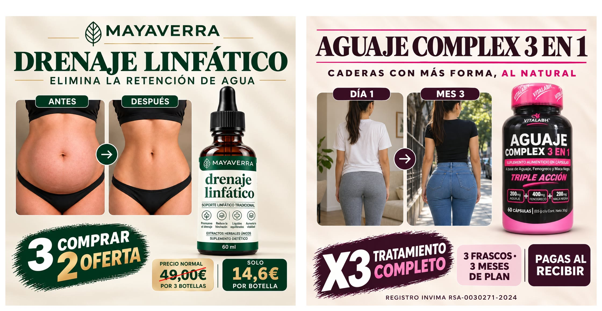
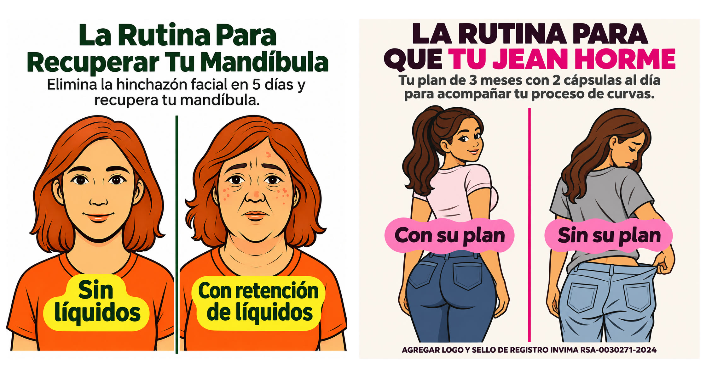

# Comparación contra las estructuras ganadoras · AGUAJE COMPLEX 3 EN 1

Pasa la imagen con 8 o más en los 7 criterios. La que falla queda marcada para rehacer: se rehace solo con tu sí (`npm run rehacer temp/_img-aguaje-complex-3-en-1-20261126-0740 --pieza V0X_1x1`).

| Imagen | Estructura | Estructura | Dolor visual | Titular | Texto limpio | Frasco fiel | Oferta y confianza | Diferencia real | Resultado |
|---|---|---|---|---|---|---|---|---|---|
| V01 | F33 (mv-01.jpg) | 9 | 8 | 9 | 9 | 9 | 9 | 9 | PASA |
| V02 | F35 (mv-03.jpg) | 9 | 6 | 9 | 9 | 9 | 8 | 9 | REHACER (Dolor visual) |
| V03 | F36 (mv-04.jpg) | 9 | 6 | 7 | 9 | 9 | 8 | 9 | REHACER (Dolor visual, Titular) |
| V04 | F34 (mv-02.jpg) | 9 | 8 | 9 | 9 | 9 | 8 | 9 | PASA |
| V05 | F38 (mv-06.jpg) | 9 | 9 | 9 | 9 | 8 | 8 | 10 | PASA |

## V01 · Antes y después 3D con descuento en estrella


## V02 · Lo invisible hecho visible


Lo que vio la revisión:
- Falta el velo gris opaco sobre las piernas del lado de antes: solo se ven unos leggings grises normales.
- Dolor visual (6): el antes ya se ve con glúteos redondos y en forma, así que el cambio no se entiende en un segundo.
- No llega a 8 en: Dolor visual (6).

Prompt corregido propuesto (se aplica solo con tu sí):

```
On the left (before) side, show visibly flatter, less defined glutes and thinner, untoned thighs in the heather-gray leggings, and add a dull, desaturated gray translucent veil over the glutes and thighs so the zone looks flat and lifeless. Keep the right (after) side, all texts, the CTA pill and the bottle exactly as they are.
```

## V03 · Línea de tiempo con sello de segmento


Lo que vio la revisión:
- Los textos, el frasco y los bloques están bien: no hay errores de escritura ni nada sobrante.
- Dolor visual (6): sin leer no se entiende el problema; solo se ven ingredientes y el frasco.
- Titular (7): ninguna palabra va resaltada; todo el titular tiene el mismo color.
- No llega a 8 en: Dolor visual (6), Titular (7).

Prompt corregido propuesto (se aplica solo con tu sí):

```
Keep everything identical, with the same texts. Render the words "TU FIGURA" in the headline in hot fuchsia #E6177F, with the rest of the headline in dark plum. Add one small flat fuchsia measuring tape illustration curling loosely next to the bottle base, on the right, so the goal of recovering the figure reads at a glance. No people, no bodies and no extra text.
```

## V04 · Antes y después real con banda de oferta y precio por unidad


## V05 · Ilustración plana lado a lado

