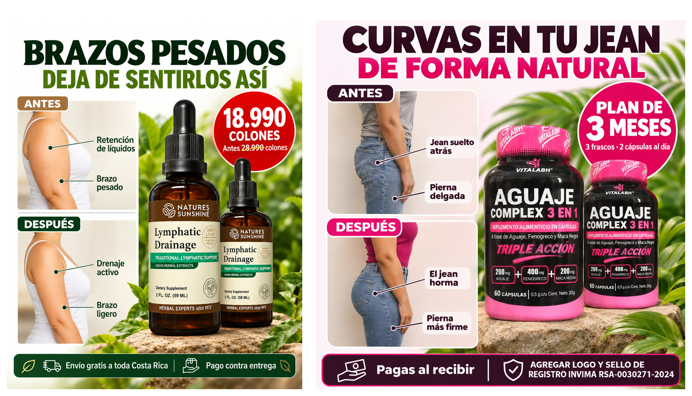
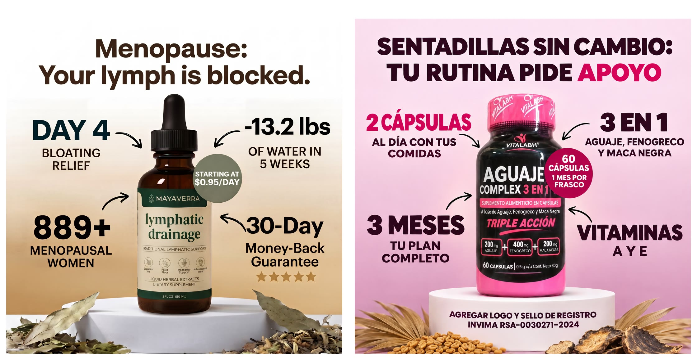
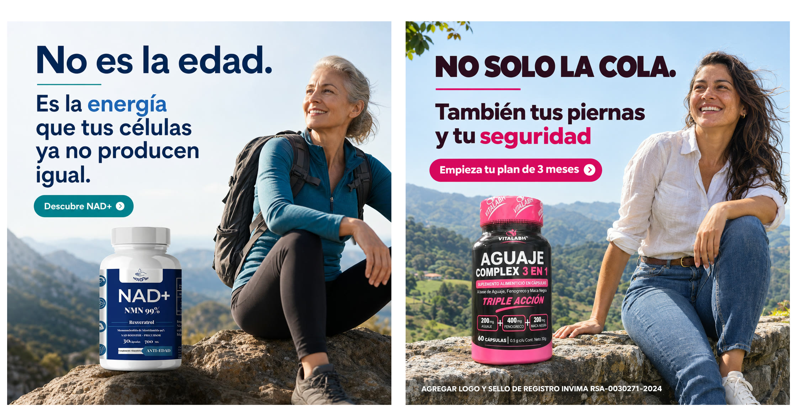
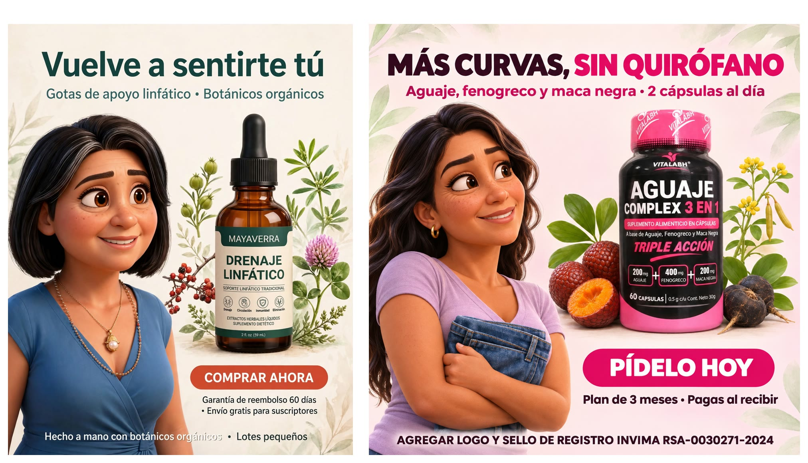
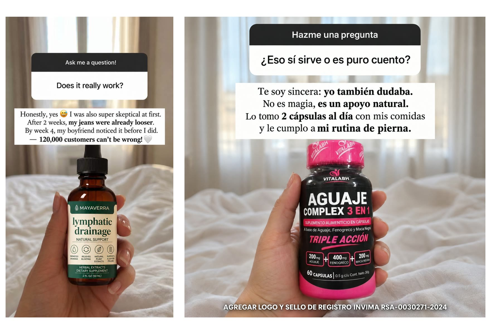
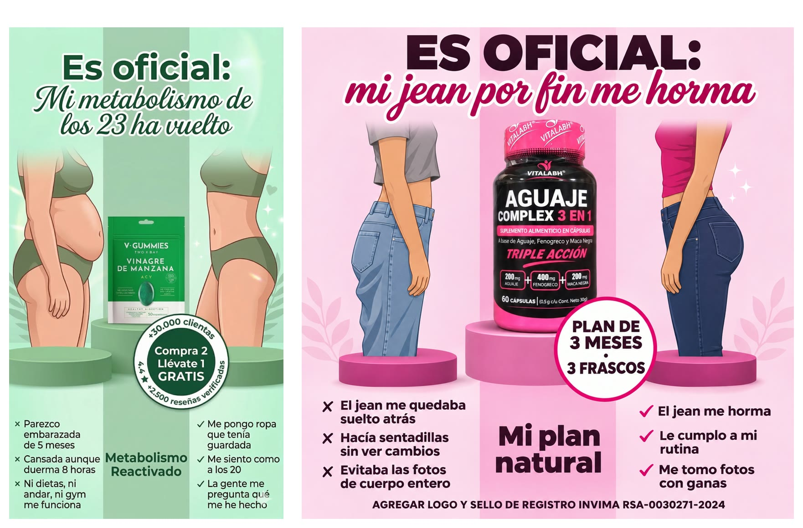
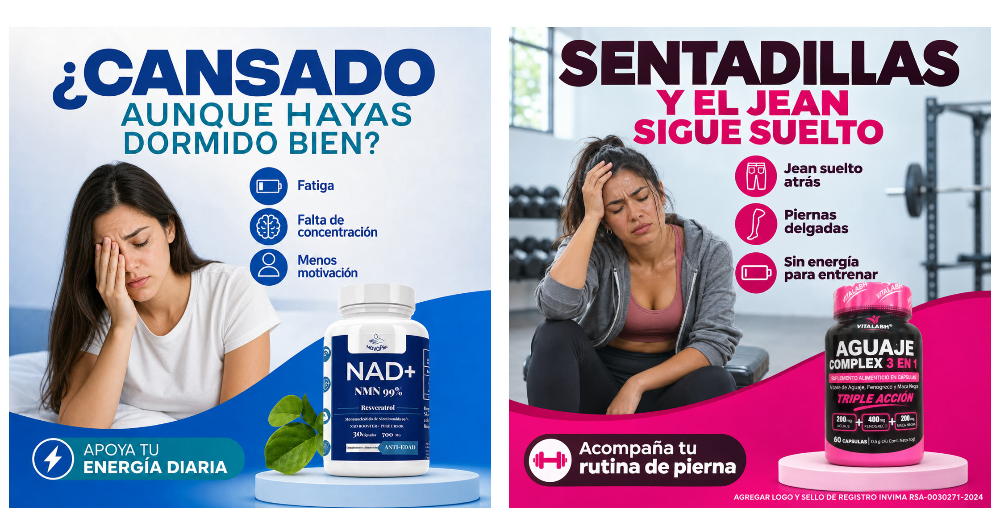
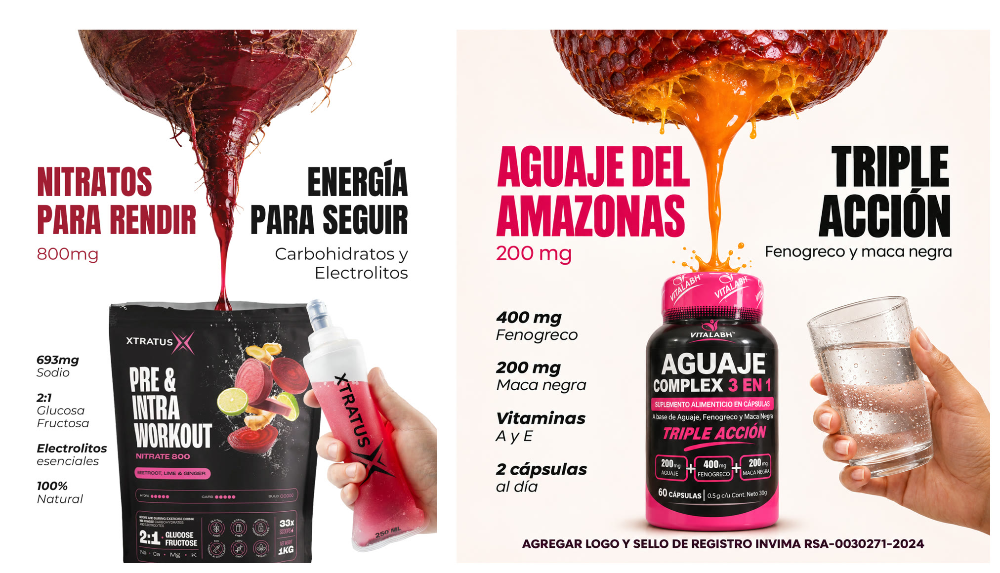
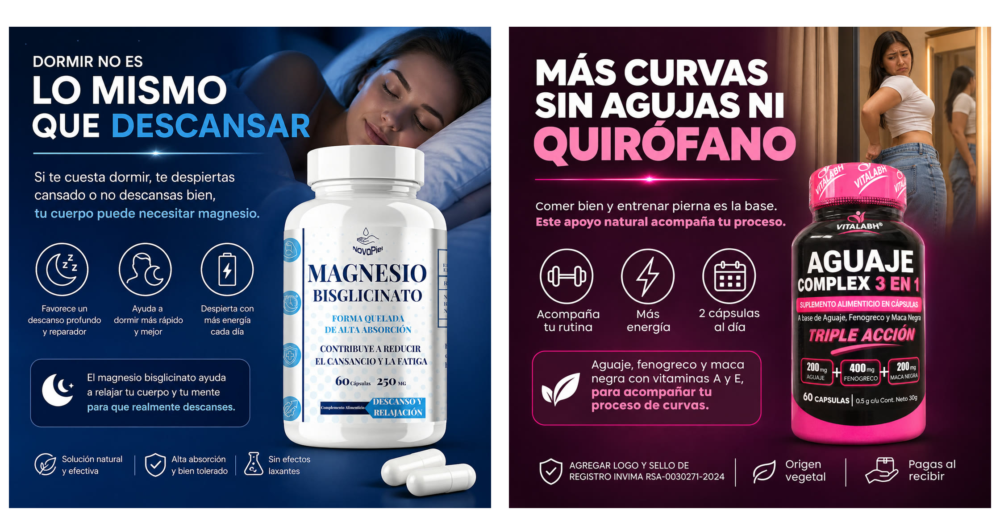
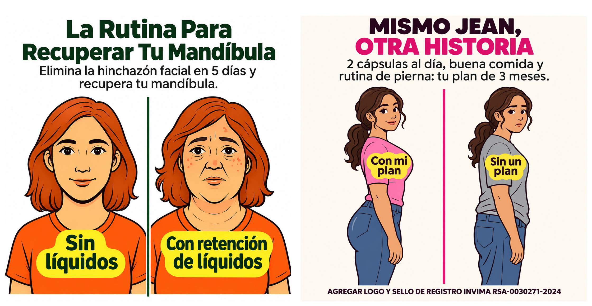

# Comparación contra las estructuras ganadoras · AGUAJE COMPLEX 3 EN 1

Pasa la imagen con 8 o más en los 7 criterios. La que falla queda marcada para rehacer: se rehace solo con tu sí (`npm run rehacer temp/_img-aguaje-complex-3-en-1-20261126-0845 --pieza V0X_1x1`).

| Imagen | Estructura | Estructura | Dolor visual | Titular | Texto limpio | Frasco fiel | Oferta y confianza | Diferencia real | Resultado |
|---|---|---|---|---|---|---|---|---|---|
| V01 | F52 (mv-22.jpg) | 9 | 9 | 9 | 9 | 9 | 8 | 9 | PASA |
| V02 | F44 (mv-14.jpg) | 9 | 5 | 8 | 9 | 9 | 7 | 9 | REHACER (Dolor visual, Oferta y confianza) |
| V03 | F64 (np-08.jpg) | 9 | 5 | 9 | 9 | 9 | 7 | 9 | REHACER (Dolor visual, Oferta y confianza) |
| V04 | F37 (mv-05.jpg) | 9 | 6 | 9 | 9 | 9 | 8 | 9 | REHACER (Dolor visual) |
| V05 | F46 (mv-16.jpg) | 9 | 8 | 8 | 9 | 9 | 8 | 9 | PASA |
| V06 | F57 (vg-08.jpg) | 9 | 8 | 9 | 9 | 9 | 8 | 9 | PASA |
| V07 | F63 (np-07.jpg) | 9 | 9 | 9 | 9 | 9 | 8 | 9 | PASA |
| V08 | F70 (xt-01.jpg) | 9 | 6 | 9 | 9 | 9 | 6 | 9 | REHACER (Dolor visual, Oferta y confianza) |
| V09 | F62 (np-06.jpg) | 9 | 8 | 9 | 9 | 9 | 8 | 9 | PASA |
| V10 | F38 (mv-06.jpg) | 9 | 9 | 9 | 10 | 9 | 8 | 9 | PASA |

## V01 · Antes y después de una zona con etiquetas, dos frascos y precio en círculo


## V02 · Frasco en pedestal con 4 datos en las esquinas y flechas


Lo que vio la revisión:
- Dolor visual: no se ve el problema. Solo hay frasco y textos, así que hay que leer para entender de qué se trata.
- Oferta y confianza: no hay bloque de oferta ni la línea «Pagas al recibir». Solo está el sello de registro en el pedestal.
- No llega a 8 en: Dolor visual (5), Oferta y confianza (7).

Prompt corregido propuesto (se aplica solo con tu sí):

```
Keep the same layout and all texts. Add a small rounded photo inset at the upper left of the bottle zone showing a woman in profile doing a squat in loose, flat-fitting jeans with a frustrated look, so the problem reads at a glance without covering any fact. On the front of the pedestal, above the seal line, add one bold dark plum line 'Pagas al recibir' with a small white hand-and-cash icon.
```

## V03 · Estilo de vida aspiracional con frase de 2 partes y frasco


Lo que vio la revisión:
- Dolor visual: la foto solo muestra el resultado feliz. El problema no se entiende sin leer.
- Oferta y confianza: solo están el botón y el sello. Falta la línea «Pagas al recibir».
- No llega a 8 en: Dolor visual (5), Oferta y confianza (7).

Prompt corregido propuesto (se aplica solo con tu sí):

```
Keep the same scene, woman, bottle and texts. Under the fuchsia pill add a small rounded white card with two side-by-side mini photos of the same jeans from the side: left labeled 'ANTES' (loose, flat fit at the back), right labeled 'DESPUÉS' (fitted, curvier), so the change reads in one second. Under it add the white line 'Pagas al recibir' with a soft dark shadow. Do not cover the bottle label.
```

## V04 · Personaje 3D emocional con botánicos


Lo que vio la revisión:
- Dolor visual: el personaje abraza el jean con esperanza, pero el problema (querer curvas y temer la cirugía) no se ve sin leer.
- No llega a 8 en: Dolor visual (6).

Prompt corregido propuesto (se aplica solo con tu sí):

```
Keep the same layout, bottle, botanicals and texts. Make the problem visible: the 3D woman holds up the folded jeans showing they are loose and empty at the back, with a slightly worried look first turning into hope toward the bottle; add a small faded thought bubble near her head with a crossed-out surgical scalpel icon (no text). Keep the bottle label fully visible.
```

## V05 · Historia de Instagram con caja de preguntas y producto en mano


## V06 · Ilustración antes y después del cuerpo con producto en pedestal y listas abajo


## V07 · Persona con el problema a la izquierda, lista de síntomas y frasco en pedestal


## V08 · Ingrediente que se derrama sobre el producto con dos titulares a los lados


Lo que vio la revisión:
- Dolor visual (6): la imagen muestra la fruta y el frasco, pero no se ve ningún problema. En 1 segundo no se entiende qué te resuelve.
- Oferta y confianza (6): no hay bloque de oferta. La confianza es solo una línea pequeña de texto abajo, sin un sello visible.
- No llega a 8 en: Dolor visual (6), Oferta y confianza (6).

Prompt corregido propuesto (se aplica solo con tu sí):

```
Keep the exact same layout, texts and bottle. Turn the bottom line into a small, clearly visible rounded trust seal centered under the bottle, with exactly 'AGREGAR LOGO Y SELLO DE REGISTRO INVIMA RSA-0030271-2024', without covering the fruit, the stream or the headlines. Add one small, clear visual cue of the problem the product addresses near the hand with the glass, with no extra text. Do not add prices, CTA buttons, stars or icons.
```

## V09 · Persona con el problema arriba, frasco grande, 3 íconos y cuadro explicativo


## V10 · Ilustración plana lado a lado

