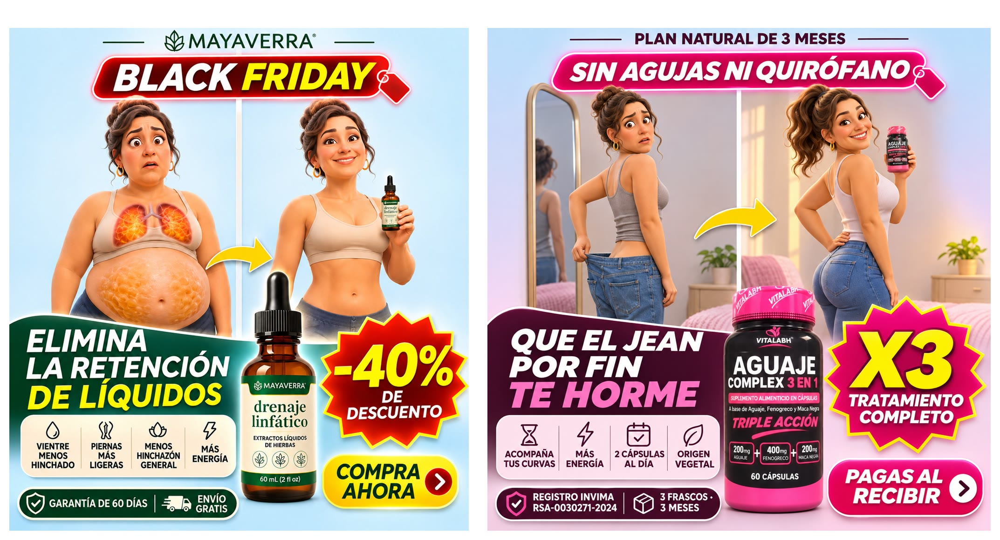
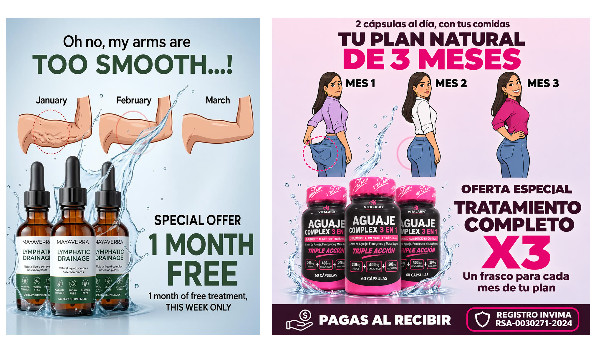
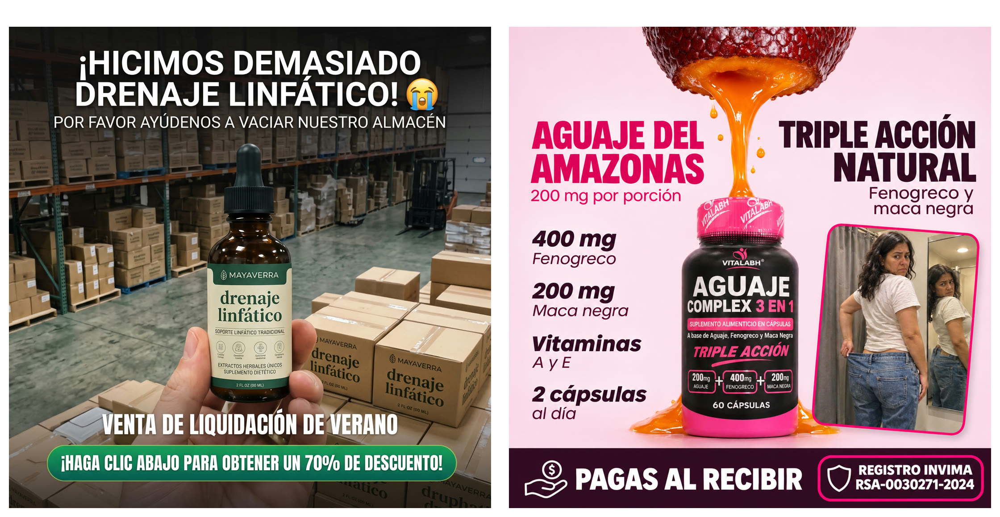
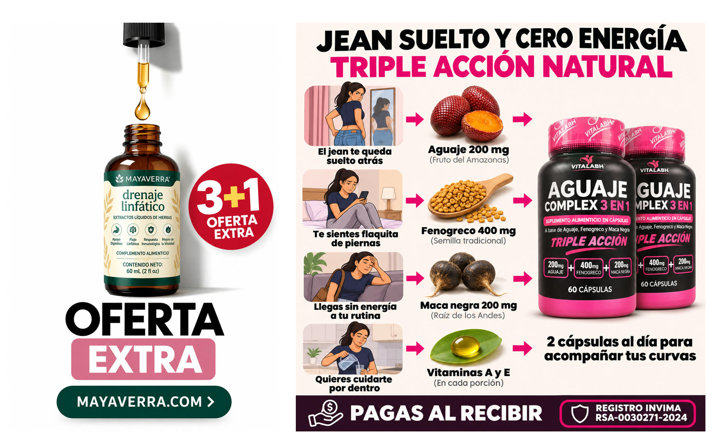
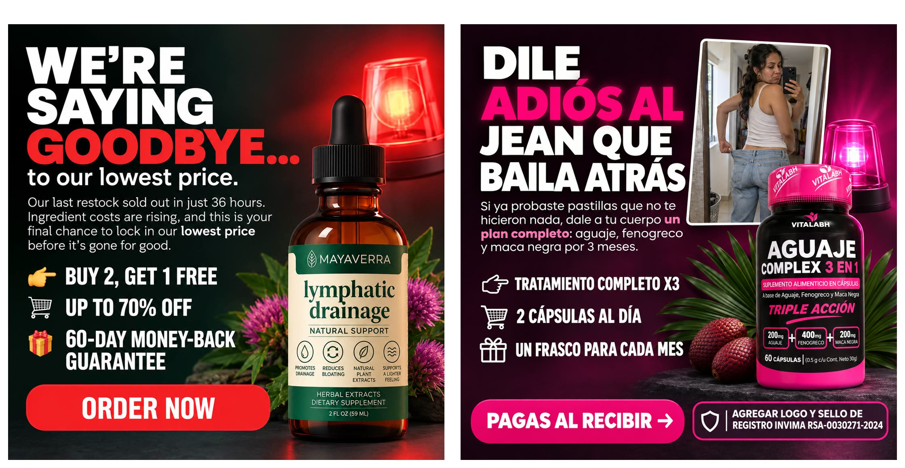
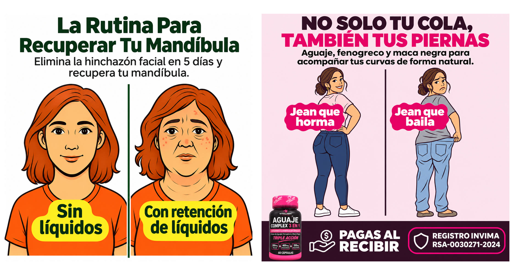
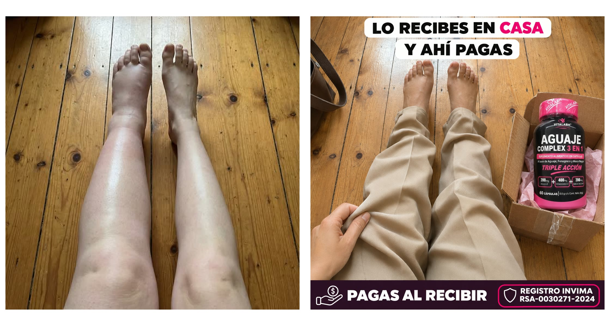
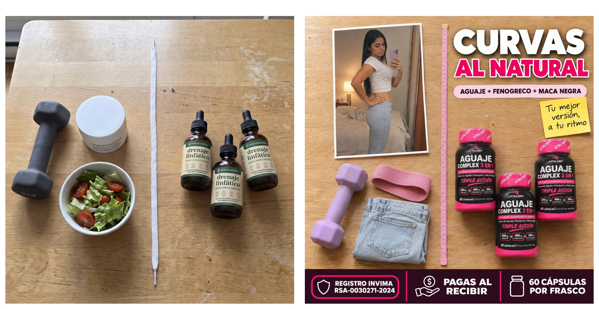
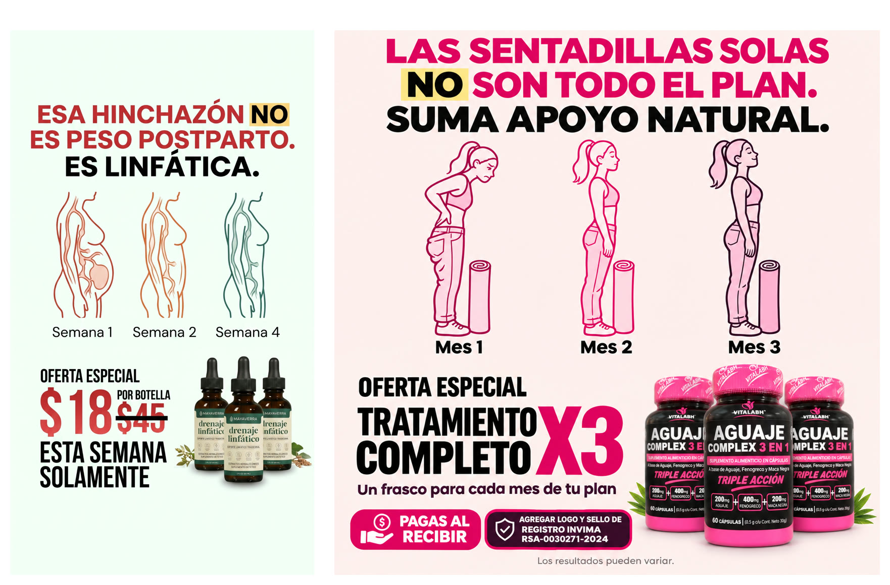
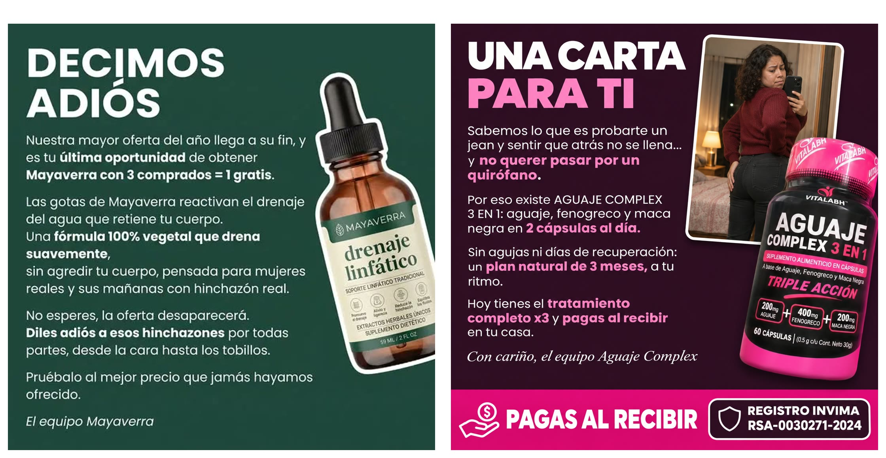

# Comparación contra las estructuras ganadoras · AGUAJE COMPLEX 3 EN 1

Pasa la imagen con 8 o más en los 7 criterios. La que falla queda marcada para rehacer: se rehace solo con tu sí (`npm run rehacer temp/_img-aguaje-complex-3-en-1-20261126-0919 --pieza V0X_1x1`).

| Imagen | Estructura | Estructura | Dolor visual | Titular | Texto limpio | Frasco fiel | Oferta y confianza | Diferencia real | Resultado |
|---|---|---|---|---|---|---|---|---|---|
| V01 | F33 (mv-01.jpg) | 9 | 9 | 9 | 9 | 9 | 9 | 8 | PASA |
| V02 | F42 (mv-11.jpg) | 9 | 8 | 9 | 9 | 9 | 8 | 8 | PASA |
| V03 | F70 (mv-40.jpg) | 3 | 8 | 8 | 9 | 9 | 8 | 8 | REHACER (Estructura) |
| V04 | F68 (mv-38.jpg) | 3 | 8 | 8 | 9 | 9 | 8 | 8 | REHACER (Estructura) |
| V05 | F43 (mv-13.jpg) | 9 | 8 | 9 | 9 | 9 | 8 | 9 | PASA |
| V06 | F38 (mv-06.jpg) | 9 | 9 | 9 | 9 | 9 | 9 | 9 | PASA |
| V07 | F61 (mv-31.jpg) | 9 | 7 | 9 | 9 | 9 | 9 | 9 | REHACER (Dolor visual) |
| V08 | F59 (mv-29.jpg) | 9 | 8 | 9 | 9 | 9 | 9 | 9 | PASA |
| V09 | F65 (mv-35.jpg) | 9 | 8 | 9 | 5 | 9 | 8 | 9 | REHACER (Texto limpio) |
| V10 | F40 (mv-08.jpg) | 8 | 9 | 9 | 9 | 9 | 9 | 9 | PASA |

## V01 · Antes y después 3D con descuento en estrella


## V02 · Línea de tiempo de 3 meses ilustrada con oferta de tratamiento


## V03 · Mano con el frasco en una bodega llena: «hicimos demasiado» y liquidación


Lo que vio la revisión:
- Estructura: no sigue la referencia que le tocaba. La referencia es una mano que sostiene el frasco en una bodega llena de cajas, con titular arriba y una franja abajo; esta imagen es una fruta que cae sobre el frasco con titulares a los lados.
- Los textos están bien escritos y el frasco es fiel; solo falla el parecido con la referencia.
- No llega a 8 en: Estructura (3).

Prompt corregido propuesto (se aplica solo con tu sí):

```
Follow the reference layout: a realistic first-person photo of a hand holding the real closed bottle at center, label facing camera, in a warehouse with shelves and stacked cardboard boxes behind. Top: 2-line white headline 'AGUAJE DEL AMAZONAS' / 'TRIPLE ACCIÓN NATURAL' with the subline 'Fenogreco y maca negra'. Near the bottom, a rounded fuchsia pill reading 'PAGAS AL RECIBIR'. Keep the dark plum bottom band with the 'REGISTRO INVIMA RSA-0030271-2024' badge. No prices, discounts or other text.
```

## V04 · Gota cayendo del gotero sobre el frasco con sello de oferta extra y botón con la web


Lo que vio la revisión:
- Estructura: no sigue la referencia que le tocaba. La referencia es un solo frasco en fondo blanco limpio, un círculo de oferta al lado, una palabra gigante abajo y un botón; esta imagen es una infografía de cuatro filas con flechas.
- Los textos están bien escritos y el frasco es fiel; solo falla el parecido con la referencia.
- No llega a 8 en: Estructura (3).

Prompt corregido propuesto (se aplica solo con tu sí):

```
Follow the reference layout: clean white background, one real closed bottle large at upper center with a soft shadow and the cap on, a few glossy orange aguaje pulp drops falling toward the cap. To the right of the bottle, a round fuchsia badge with a big white 'X3' and 'TRATAMIENTO COMPLETO' under it. Below the bottle, huge black word 'TRIPLE ACCIÓN' and under it 'NATURAL' in white inside a fuchsia rounded block. At the bottom, a dark plum rounded button 'PAGAS AL RECIBIR' and a small bordered badge 'REGISTRO INVIMA RSA-0030271-2024'. No other text.
```

## V05 · Fondo oscuro con sirena de urgencia, lista de 3 ofertas y botón


## V06 · Ilustración plana lado a lado


## V07 · Foto cenital de pies y piernas con el problema sobre piso de madera, sin texto


Lo que vio la revisión:
- Dolor visual (7): el pantalón se ve como un pantalón ancho normal. En un segundo no se entiende que le queda grande, porque la pierna delgada no se ve y la mano casi no levanta tela.
- No llega a 8 en: Dolor visual (7).

Prompt corregido propuesto (se aplica solo con tu sí):

```
Keep everything else identical. Make the problem obvious at a glance: her hand pulls a big empty fold of the beige trousers far up and away from the thigh, showing a wide gap of air between fabric and leg; one trouser hem is pushed up so a visibly thin ankle and shin show inside the wide opening; the trousers must clearly look two sizes too big. Keep the texts exactly as they are.
```

## V08 · Bodegón cenital: lo que no funcionó (pesa, ensalada, cinta) junto a los frascos


## V09 · Reencuadre del problema por segmento con 3 siluetas ilustradas y precio tachado


Lo que vio la revisión:
- Texto limpio: el sello dice «AGREGAR LOGO Y SELLO DE», que es una nota para ti, no texto del anuncio. Debe decir solo «REGISTRO INVIMA RSA-0030271-2024».
- No llega a 8 en: Texto limpio (5).

Prompt corregido propuesto (se aplica solo con tu sí):

```
In the dark plum badge next to the 'PAGAS AL RECIBIR' pill, write only two lines: 'REGISTRO INVIMA' and 'RSA-0030271-2024'. Remove the words 'AGREGAR LOGO Y SELLO DE' completely; never write them anywhere.
```

## V10 · Carta de texto

