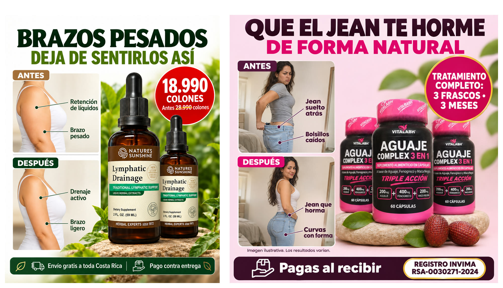
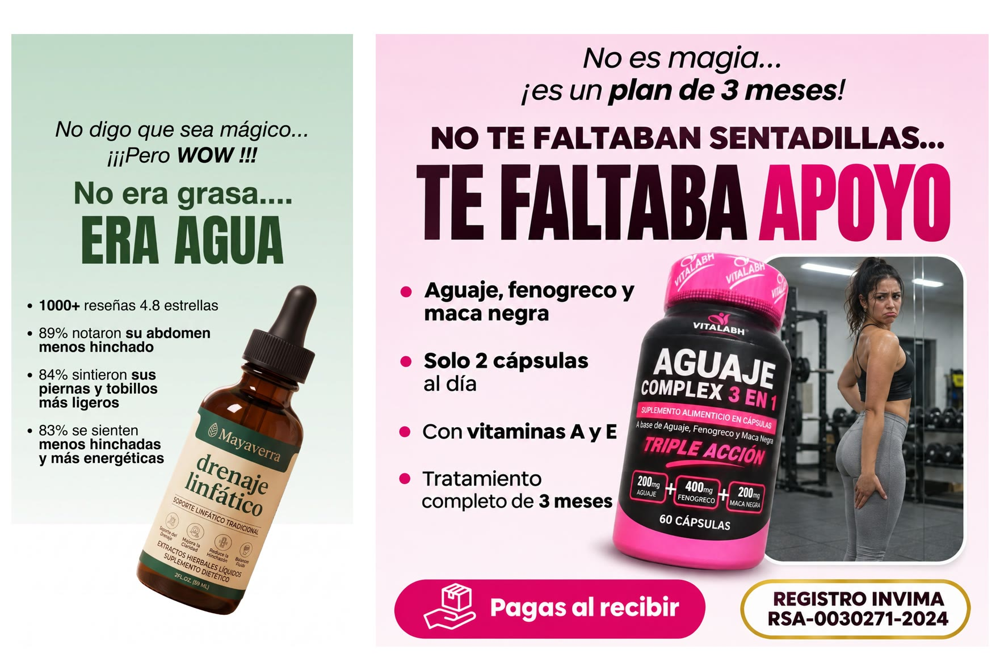
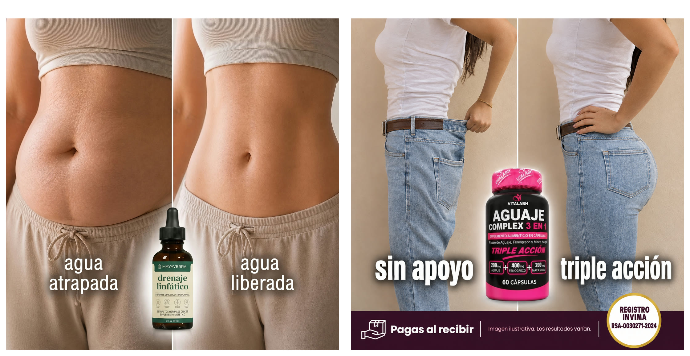
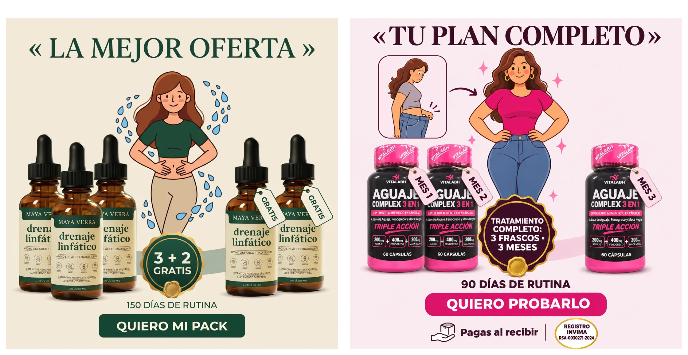
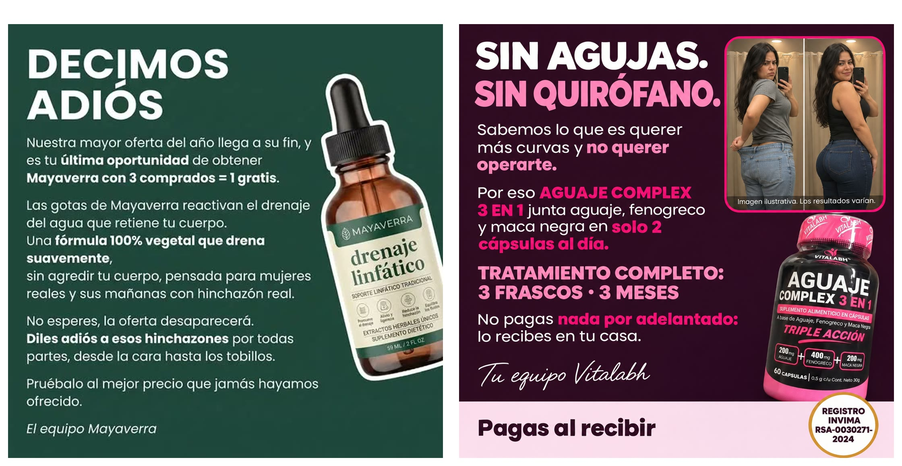

# Comparación contra las estructuras ganadoras · AGUAJE COMPLEX 3 EN 1

Pasa la imagen con 8 o más en los 7 criterios. La que falla queda marcada para rehacer: se rehace solo con tu sí (`npm run rehacer temp/_img-aguaje-complex-3-en-1-20261126-1116 --pieza V0X_1x1`).

| Imagen | Estructura | Estructura | Dolor visual | Titular | Texto limpio | Frasco fiel | Oferta y confianza | Diferencia real | Resultado |
|---|---|---|---|---|---|---|---|---|---|
| V01 | F52 (mv-22.jpg) | 9 | 9 | 8 | 9 | 9 | 9 | 8 | PASA |
| V02 | F80 (mv-50.jpg) | 8 | 6 | 9 | 9 | 9 | 8 | 9 | REHACER (Dolor visual) |
| V03 | F64 (mv-34.jpg) | 9 | 9 | 7 | 9 | 9 | 7 | 8 | REHACER (Titular, Oferta y confianza) |
| V04 | F69 (mv-39.jpg) | 9 | 8 | 7 | 9 | 8 | 9 | 9 | REHACER (Titular) |
| V05 | F40 (mv-08.jpg) | 8 | 9 | 8 | 9 | 9 | 8 | 9 | PASA |

## V01 · Antes y después de una zona con etiquetas, dos frascos y precio en círculo


## V02 · Testimonio honesto («no digo que sea mágico… pero») con revelación y porcentajes de clientas


Lo que vio la revisión:
- Dolor visual: la foto del gimnasio solo muestra a la mujer triste, sin el resultado. Además sus glúteos ya se ven redondos en el leggins, así que no se entiende el problema.
- No llega a 8 en: Dolor visual (6).

Prompt corregido propuesto (se aplica solo con tu sí):

```
Keep everything else. Replace the gym photo card with a split card: left half the same woman in profile in grey leggings with a visibly flat seat and thin straight legs, frustrated; right half the same woman, same leggings and framing, with a rounder lifted seat and fuller thighs filling the leggings, smiling. The change must be obvious at first glance.
```

## V03 · Antes y después de una zona dividido al medio con dos palabras del mecanismo y el frasco al centro


Lo que vio la revisión:
- Oferta y confianza: no aparece la oferta del tratamiento (3 frascos, 3 meses); solo están el pago al recibir y el registro.
- Titular: no hay titular; solo las dos palabras «sin apoyo» y «triple acción», sin una palabra resaltada en color.
- No llega a 8 en: Titular (7), Oferta y confianza (7).

Prompt corregido propuesto (se aplica solo con tu sí):

```
Keep the split photo, the bottle and the words. Write 'triple acción' in hot fuchsia #E6177F with a soft dark shadow, keep 'sin apoyo' in white. Add a small round hot fuchsia seal with a thin gold ring at the upper center over the white seam, reading 'TRATAMIENTO COMPLETO: 3 FRASCOS · 3 MESES' in white bold on three lines, not covering the jeans.
```

## V04 · Ilustración de la mujer aliviada al centro con frascos alrededor, etiquetas de regalo y sello del pack


Lo que vio la revisión:
- Titular: «TU PLAN COMPLETO» no tiene ninguna palabra resaltada en otro color.
- No llega a 8 en: Titular (7).

Prompt corregido propuesto (se aplica solo con tu sí):

```
Keep everything else. In the headline '«TU PLAN COMPLETO»', write the word 'COMPLETO' in hot fuchsia #E6177F and keep '«TU PLAN' and '»' in dark plum #2B1226.
```

## V05 · Carta de texto

