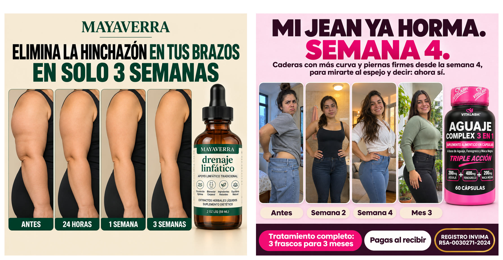
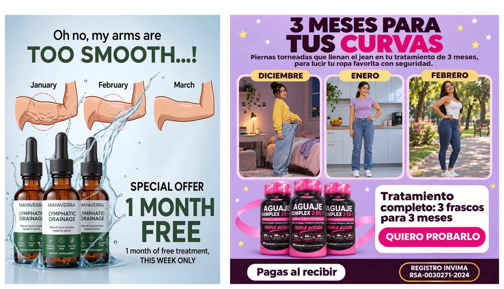
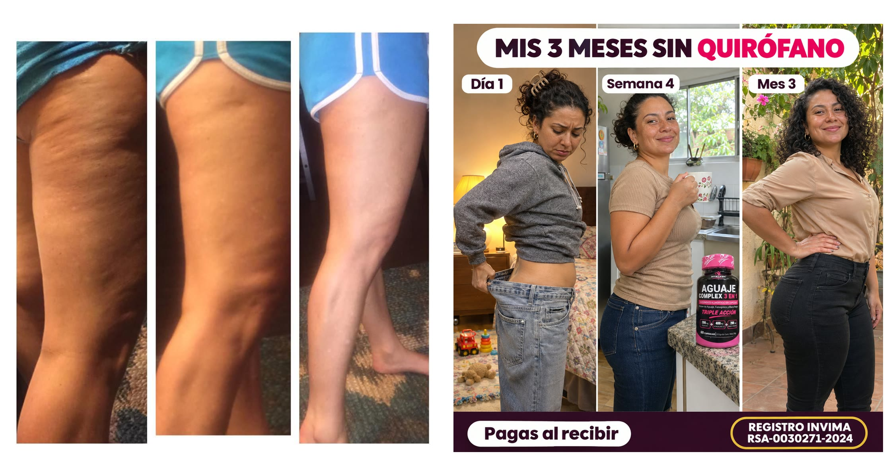
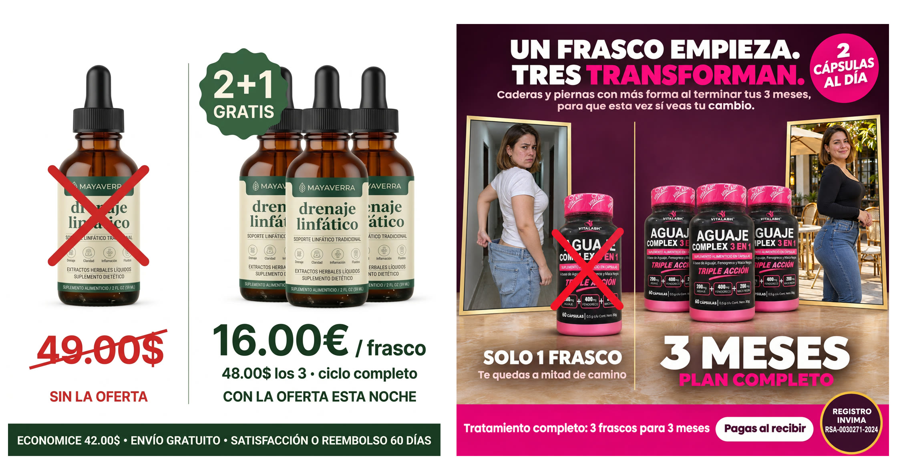
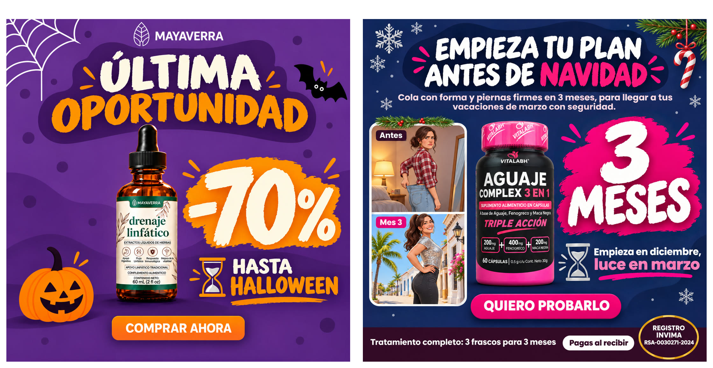
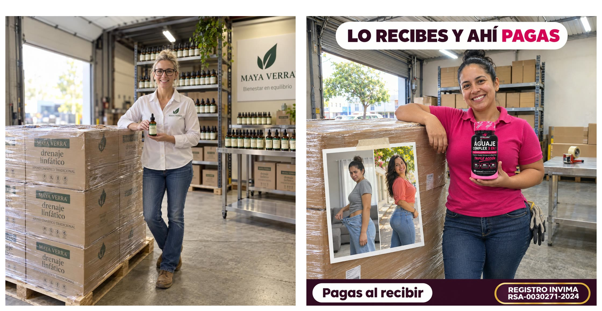
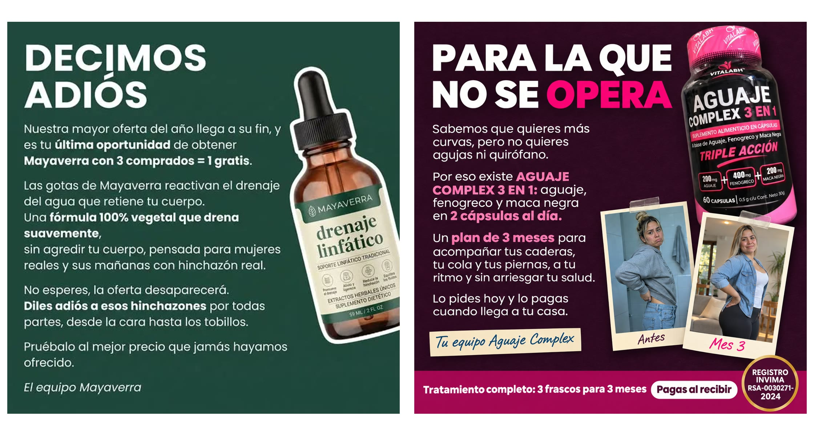
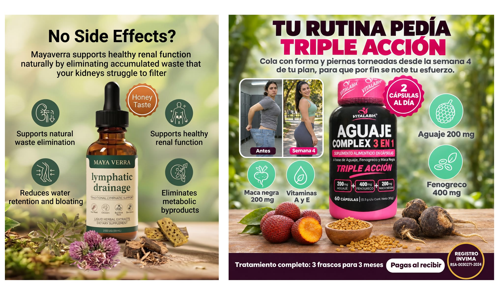
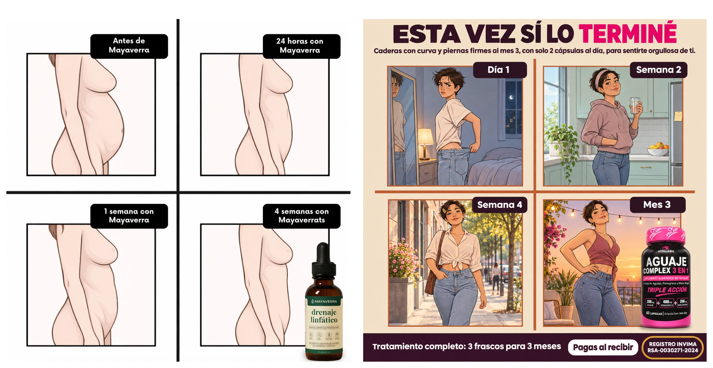

# Comparación contra las estructuras ganadoras · AGUAJE COMPLEX 3 EN 1

Pasa la imagen con 8 o más en los 7 criterios. La que falla queda marcada para rehacer: se rehace solo con tu sí (`npm run rehacer temp/_img-aguaje-complex-3-en-1-20261127-0834 --pieza V0X_1x1`).

| Imagen | Estructura | Estructura | Dolor visual | Titular | Texto limpio | Frasco fiel | Oferta y confianza | Diferencia real | Resultado |
|---|---|---|---|---|---|---|---|---|---|
| V01 | F86 (mv-56.jpg) | 9 | 8 | 9 | 9 | 9 | 9 | 8 | PASA |
| V02 | F42 (mv-11.jpg) | 8 | 8 | 9 | 7 | 7 | 8 | 8 | REHACER (Texto limpio, Frasco fiel) |
| V03 | F53 (mv-23.jpg) | 8 | 9 | 9 | 9 | 8 | 7 | 8 | REHACER (Oferta y confianza) |
| V04 | F77 (mv-47.jpg) | 8 | 8 | 9 | 9 | 8 | 9 | 9 | PASA |
| V06 | F71 (mv-41.jpg) | 9 | 9 | 9 | 9 | 9 | 9 | 9 | PASA |
| V07 | F60 (mv-30.jpg) | 9 | 8 | 9 | 9 | 9 | 8 | 9 | PASA |
| V08 | F40 (mv-08.jpg) | 8 | 8 | 9 | 9 | 9 | 9 | 8 | PASA |
| V09 | F50 (mv-20.jpg) | 9 | 8 | 9 | 9 | 9 | 9 | 9 | PASA |
| V10 | F55 (mv-25.jpg) | 9 | 8 | 9 | 9 | 9 | 8 | 9 | PASA |

## V01 · Fila de 4 fotos de la misma zona (antes, 24 horas, 1 semana, 3 semanas) con titular de 2 colores y frasco


## V02 · Línea de tiempo de 3 meses ilustrada con oferta de tratamiento


Lo que vio la revisión:
- En la etiqueta del frasco del medio dice «MACA MEDIA» en vez de «MACA NEGRA» (Texto limpio).
- Los frascos de los lados quedan tapados por el del medio y se pierde parte de su etiqueta, y se ven brillantes en vez de mate (Frasco fiel).
- No llega a 8 en: Texto limpio (7), Frasco fiel (7).

Prompt corregido propuesto (se aplica solo con tu sí):

```
Keep the layout. Fix the three bottles: copy the attached product photo exactly; the third ingredient box on every label must read '200mg MACA NEGRA' (never 'MACA MEDIA'). Space the three bottles slightly apart so each full label is visible and readable, matte finish, no glossy highlights.
```

## V03 · Tres fotos reales de la misma zona en progreso, sin texto


Lo que vio la revisión:
- No aparece la oferta «Tratamiento completo: 3 frascos para 3 meses»: la franja de abajo solo tiene «Pagas al recibir» y el registro (Oferta y confianza).
- No llega a 8 en: Oferta y confianza (7).

Prompt corregido propuesto (se aplica solo con tu sí):

```
Keep everything the same. In the bottom plum strip add, between the 'Pagas al recibir' pill and the registration badge, a hot fuchsia #E6177F pill with white bold text exactly 'Tratamiento completo: 3 frascos para 3 meses'. Make the strip slightly taller if needed; do not cover the photos' jeans area.
```

## V04 · Comparación de precio: un frasco tachado contra el pack con precio por unidad y franja de beneficios


## V06 · Oferta de temporada: titular de última oportunidad, % gigante, reloj de arena y botón


## V07 · La fundadora en la bodega con palés de cajas y el frasco en la mano


## V08 · Carta de texto


## V09 · Frasco al centro con 4 beneficios con íconos alrededor y fondo botánico


Lo que vio la revisión:
- En la foto «Semana 4» la mujer sale de espaldas y la imagen se centra en la cola. El anuncio pedía que mirara a la cámara o de tres cuartos, sin poses de espaldas. Meta puede rechazar el anuncio por esto.

## V10 · Cuadrícula de 4 momentos en ilustración de línea (antes, 24 horas, 1 semana, 4 semanas)

