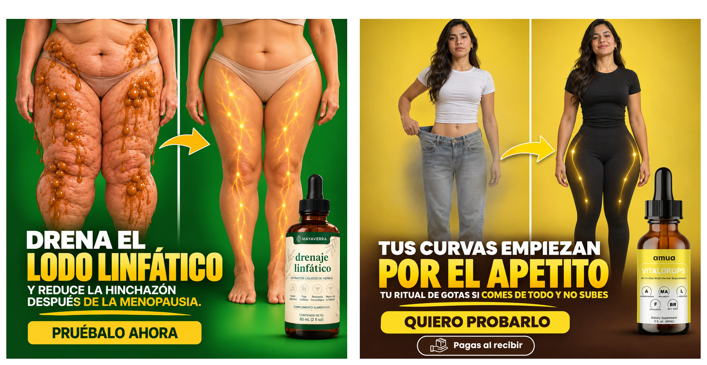
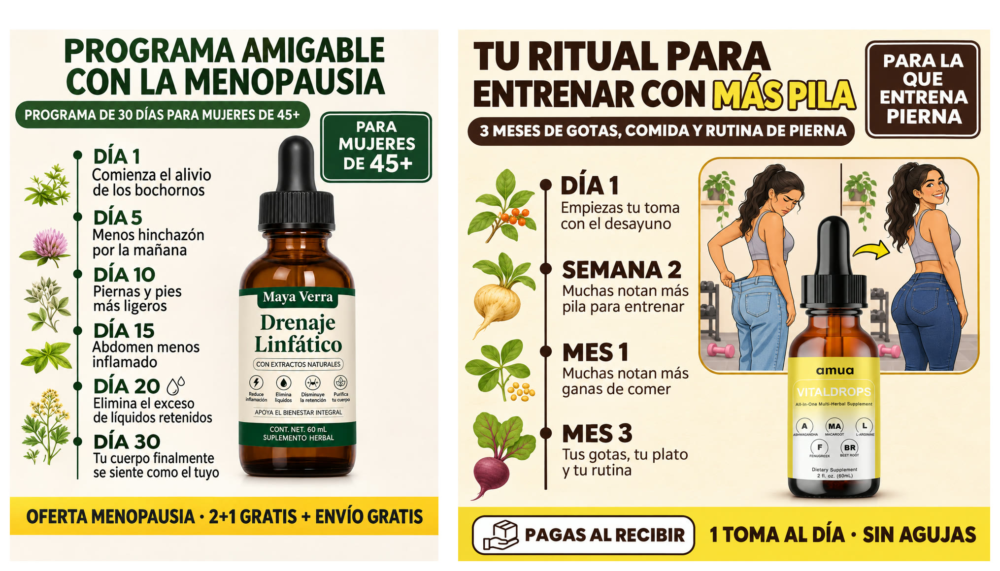
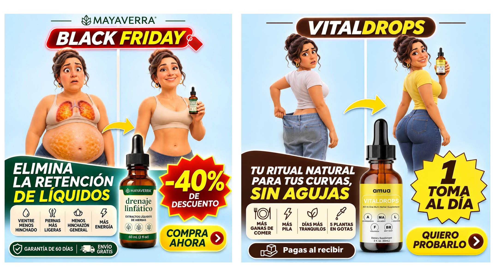
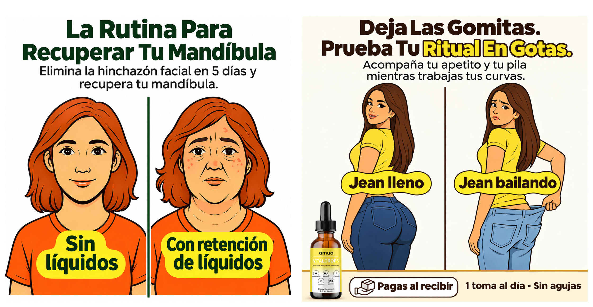

# Comparación contra las estructuras ganadoras · VITALDROPS

Pasa la imagen con 8 o más en los 7 criterios. La que falla queda marcada para rehacer: se rehace solo con tu sí (`npm run rehacer temp/_img-vitaldrops-20261126-1119 --pieza V0X_1x1`).

| Imagen | Estructura | Estructura | Dolor visual | Titular | Texto limpio | Frasco fiel | Oferta y confianza | Diferencia real | Resultado |
|---|---|---|---|---|---|---|---|---|---|
| V01 | F35 (mv-03.jpg) | 9 | 9 | 9 | 9 | 9 | 8 | 9 | PASA |
| V02 | F36 (mv-04.jpg) | 9 | 8 | 9 | 9 | 9 | 9 | 8 | PASA |
| V03 | F33 (mv-01.jpg) | 9 | 9 | 9 | 8 | 8 | 9 | 8 | PASA |
| V04 | F38 (mv-06.jpg) | 9 | 9 | 8 | 9 | 8 | 8 | 8 | PASA |
| V05 | F34 (mv-02.jpg) | 9 | 8 | 7 | 9 | 9 | 8 | 9 | REHACER (Titular) |

## V01 · Lo invisible hecho visible


## V02 · Línea de tiempo con sello de segmento


## V03 · Antes y después 3D con descuento en estrella


## V04 · Ilustración plana lado a lado


## V05 · Antes y después real con banda de oferta y precio por unidad


Lo que vio la revisión:
- Titular: no tiene ninguna palabra resaltada. «VITALDROPS» y «TU RITUAL DIARIO PARA TUS CURVAS» van en el mismo color café, así que nada destaca la promesa.
- No llega a 8 en: Titular (7).

Prompt corregido propuesto (se aplica solo con tu sí):

```
Keep everything exactly as it is. Only change the subtitle: write it exactly as "TU RITUAL DIARIO PARA TUS CURVAS" and highlight the word "CURVAS" by setting it in bold gold #C9962B (or inside a small lemon-yellow #F5E13A highlight box with cocoa text), while the rest of the subtitle stays deep cocoa. Do not add any other text.
```
