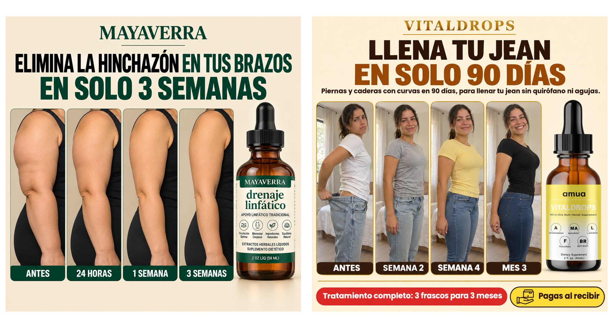
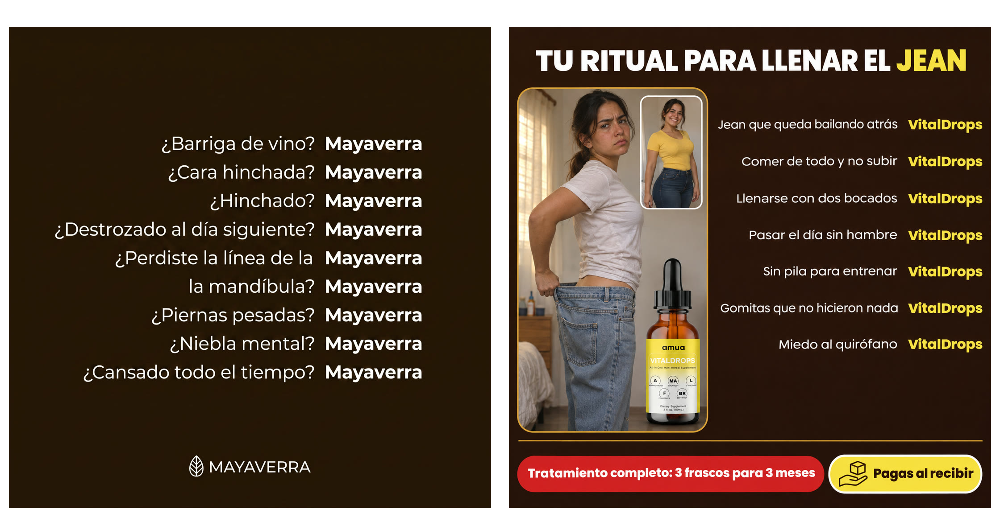
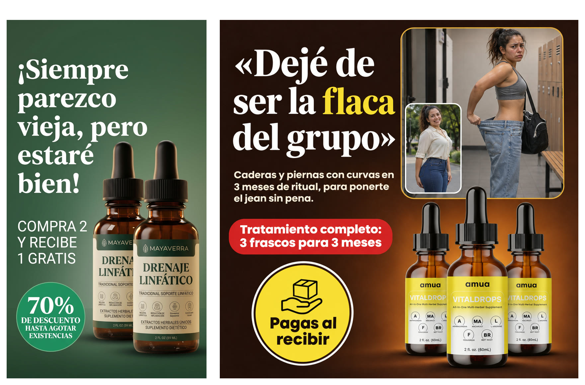
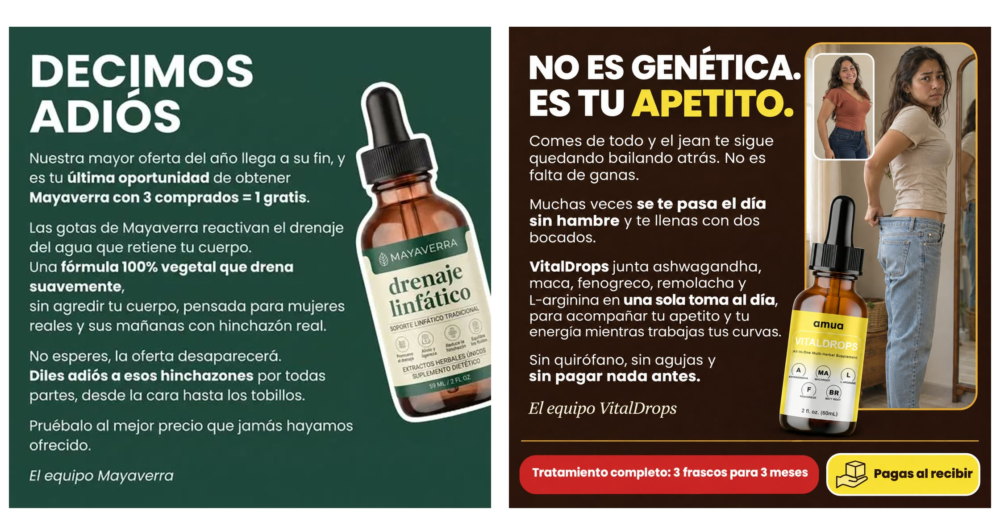
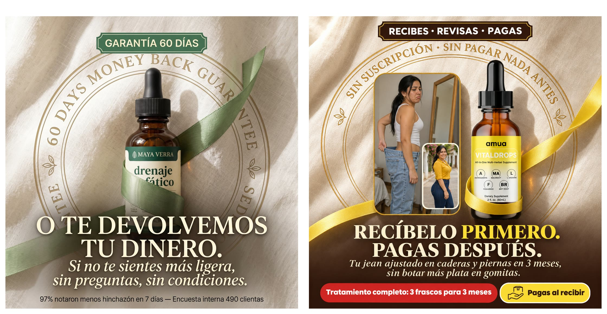

# Comparación contra las estructuras ganadoras · VITALDROPS

Pasa la imagen con 8 o más en los 7 criterios. La que falla queda marcada para rehacer: se rehace solo con tu sí (`npm run rehacer temp/_img-vitaldrops-20261126-1353 --pieza V0X_1x1`).

| Imagen | Estructura | Estructura | Dolor visual | Titular | Texto limpio | Frasco fiel | Oferta y confianza | Diferencia real | Resultado |
|---|---|---|---|---|---|---|---|---|---|
| V01 | F86 (mv-56.jpg) | 9 | 9 | 9 | 9 | 9 | 9 | 9 | PASA |
| V02 | F54 (mv-24.jpg) | 8 | 8 | 8 | 9 | 9 | 9 | 9 | PASA |
| V03 | F57 (mv-27.jpg) | 8 | 9 | 9 | 9 | 9 | 8 | 9 | PASA |
| V04 | F40 (mv-08.jpg) | 8 | 8 | 9 | 9 | 9 | 8 | 9 | PASA |
| V05 | F85 (mv-55.jpg) | 8 | 8 | 9 | 9 | 9 | 9 | 8 | PASA |

## V01 · Fila de 4 fotos de la misma zona (antes, 24 horas, 1 semana, 3 semanas) con titular de 2 colores y frasco

## V02 · Lista de preguntas de síntomas con la marca como respuesta, fondo oscuro

## V03 · Frase de clienta gigante, dos frascos y círculo de descuento, fondo verde

## V04 · Carta de texto

## V05 · La garantía como protagonista: sello circular grande detrás del frasco con cinta y titular de devolución

